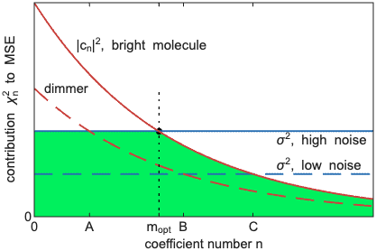
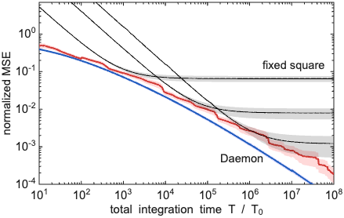

# Adaptive Sampling in 2D spectroscopy of a single molecule

This repository contains the Matlab code and the resulting data for an adaptive sampling algorithm used in 2D Fourier-transform spectroscopy under high-noise conditions. It supplements our publication

* S. Stadler et al., Adaptive Sampling in Fluorescence-Detected 2D Spectroscopy, Arxiv 2026

A measured coefficient contributes its variance to the MSE, whereas a not-yet-measured coefficient contributes its absolute value squared. This helps to determine which coefficients should be measured, but an estimate of the unmeasured values is required.

We estimate the values that have not yet been measured using a simple exponential model. This produces an MSE (red) that closely resembles the ideal case (blue) when plotted against integration time.

## Credit

We have made slight modifications to the following Matlab functions, which we obtained from other sources

* **bwperimtrace.m** by **Daniel Warren**, Department of Oncology, University of Oxford (2014), found at [matlabcentral](https://de.mathworks.com/matlabcentral/fileexchange/49551-trace-perimeter-of-binary-image-with-line-segments-bwperimtrace) for isolines in 2d heatmaps that follow the edge of the pixels

* **scifig.m** by **Urban J. Wuensch**, Department of Architecture and Civil Engineering, Chalmers University of Technology (2025), found at [matlabcentral](https://de.mathworks.com/matlabcentral/fileexchange/182491-scifig-scientific-figures-for-publications) for styling the output graphics consistently.

*  **brewermap.m** by **Stephen Cobeldick** (2024), found at [matlabcentral](https://de.mathworks.com/matlabcentral/fileexchange/45208-colorbrewer-attractive-and-distinctive-colormaps) and [github](https://github.com/DrosteEffect/BrewerMap). Modified to allow nonlinear Gamma scaling.

We found the 'export_fig' function useful for exporting 2D heatmaps as combined vector plus bitmap graphics

* **export.fig**  by **Oliver J. Woodford** and **Yair M. Altman** (2026)
found at 
[matlabcentral](https://de.mathworks.com/matlabcentral/fileexchange/23629-export_fig) and [github](https://github.com/altmany/export_fig)

 
## Licence

The code is licensed under the [MIT license](LICENSE). If you use this code for scientific work, please consider citing our publication listed above.